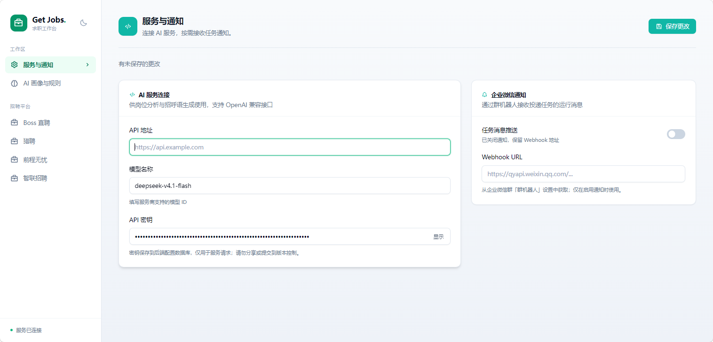
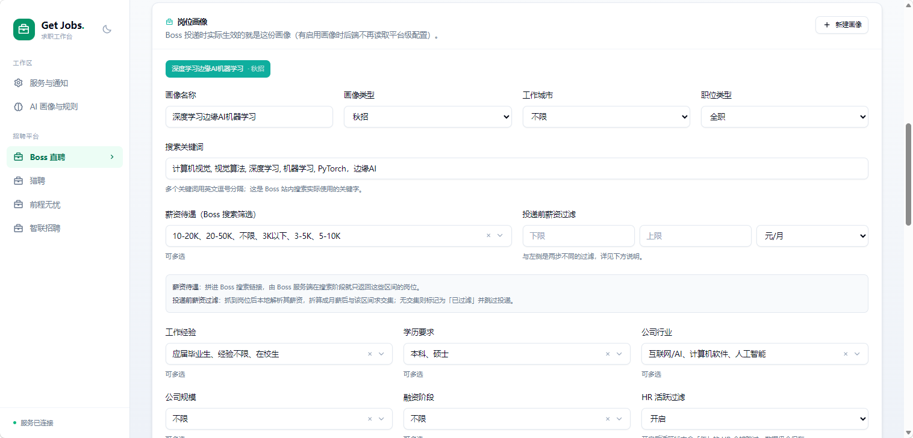
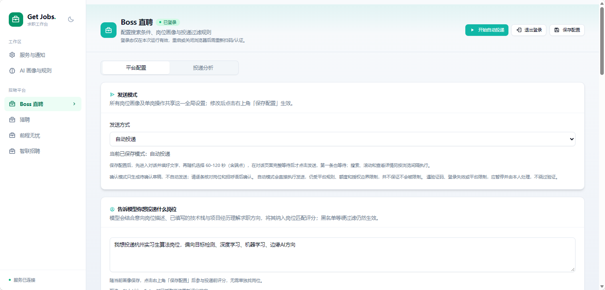

<div align="center">

# AI 求职助手

**本地运行的求职管理台：岗位搜索 · AI 匹配 · 沟通草稿 · 投递分析**

支持 BOSS 直聘、猎聘、前程无忧、智联招聘。


[快速开始](#快速开始) · [核心功能](#核心功能) · [界面预览](#界面预览) · [配置](#配置优先级) · [隐私](#数据与隐私) · [许可](#来源与许可)

</div>

---

## 项目简介

AI 求职助手是一个**在本地运行**的求职管理工具，使用 Java 21、Spring Boot、SQLite 和 Next.js 构建。它把岗位搜索、条件筛选、AI 匹配评分、沟通草稿与投递分析集中在网页管理界面，支持 BOSS 直聘、猎聘、前程无忧和智联招聘。

本整理版基于上游 [GET JOBS](https://github.com/loks666/get_jobs) 项目，保留既有业务逻辑，补充环境变量读取、空白数据库初始化和发布前的隐私检查。项目名称、说明和使用文档使用中文；GitHub 仓库地址使用拼音标识 `ai-qiuzhi-zhushou`。

> [!IMPORTANT]
> 本项目沿用上游的 **PolyForm Noncommercial 1.0.0** 许可证，仅允许许可证范围内的非商业使用。请仅管理你本人的招聘账号，并在理解并遵守各平台规则的前提下使用投递功能。

## 界面预览

<p align="center">
  
</p>

<p align="center"><em>服务与通知：配置 AI 服务与企业微信通知</em></p>

| 岗位画像 | BOSS 直聘 |
|:---:|:---:|
|  |  |
| 设置求职方向、筛选条件与投递偏好 | 配置发送模式与岗位投递意向 |

## 核心功能

| 功能 | 说明 |
|---|---|
| **多平台配置** | 在网页配置城市、关键词、薪资、学历和经验等条件，各平台能力有所不同 |
| **AI 岗位匹配** | 按岗位要求、工作职责与求职偏好评分，支持个人画像、岗位意向和匹配阈值 |
| **沟通草稿** | BOSS 支持生成个性化打招呼语，默认采用逐条确认模式 |
| **投递队列** | 管理待确认、已发送和结果未知的记录，保留去重、暂停与限速状态 |
| **筛选与黑名单** | 支持薪资条件、企业黑名单和部分平台的 HR 活跃度筛选 |
| **数据分析** | 查看平台投递记录、关键词和薪资分布等统计 |
| **可选通知** | 通过自行配置的企业微信机器人推送运行信息 |
| **隐私保护** | 密钥使用环境变量或本地 `.env`，数据库、Cookie、浏览器会话与日志不入库 |

详细的评分权重、平台差异和投递状态说明见 [功能详解](docs/功能详解.md)。

## 技术栈

| 层 | 技术 |
|---|---|
| 后端 | Java 21 · Spring Boot 3.5 · Gradle Wrapper |
| 数据 | SQLite（空白库由脚本初始化） |
| 前端 | Next.js 16 · React 19 · TypeScript · Tailwind CSS |
| 浏览器自动化 | 本机 Chrome / Chromium 与对应驱动 |
| 可选启动器 | Python 3.10+（`run.py`） |

## 快速开始

### 1. 环境要求

| 依赖 | 要求 |
|---|---|
| JDK | 21，并将 `JAVA_HOME` 指向该 JDK |
| Node.js | 22.14 或以上，用于前端构建和 SQLite 初始化脚本 |
| pnpm | 安装前端依赖；仓库已附 `pnpm-lock.yaml` |
| Git | 拉取代码；Gradle 使用仓库自带 Wrapper，无需单独安装 |
| Python | 3.10+，**可选**，仅使用 `run.py` 时需要 |
| 其他 | 本机图形桌面与可用的 Chrome / Chromium；首次安装依赖与浏览器驱动需要网络 |

### 2. 获取代码

```bash
git clone https://github.com/casdad/ai-qiuzhi-zhushou.git
cd ai-qiuzhi-zhushou
```

### 3. 创建本地配置

Windows PowerShell：

```powershell
Copy-Item .env.example .env
```

macOS / Linux：

```bash
cp .env.example .env
```

在本地 `.env` 中填写自己的配置，或使用同名的系统环境变量：

```dotenv
BASE_URL=https://api.openai.com
API_KEY=your-api-key
MODEL=your-model-name
HOOK_URL=
BOT_IS_SEND=false
```

### 4. 初始化空白数据库

首次运行时，在项目根目录执行：

```bash
node scripts/init-db.mjs
```

脚本创建 `db/getjobs.db`，只导入表结构和城市、行业、学历、薪资等公共选项，**不包含**简历、个人画像、密钥、Cookie、投递记录或黑名单。若目标文件已存在，脚本会停止，避免覆盖已有数据。升级时直接保留自己的 `db/`。

### 5. 安装与构建前端

```bash
cd front
pnpm install --frozen-lockfile
node node_modules/next/dist/bin/next build
node scripts/copy-dist.mjs
cd ..
```

前端静态页面会复制到 `src/main/resources/dist/`。依赖和编译结果由本机生成，不上传到仓库。

### 6. 启动后端

Windows PowerShell：

```powershell
.\gradlew.bat bootRun
```

macOS / Linux：

```bash
chmod +x gradlew
./gradlew bootRun
```

构建任务会准备浏览器驱动。启动后访问 <http://127.0.0.1:9527>，后端默认仅监听本机地址。

也可以在完成上述初始化后使用 `python run.py` 启动；Windows 启动器可核对并重启当前项目的旧实例。

前端开发时，在 `front/` 执行 `pnpm dev`，访问 <http://127.0.0.1:6866>，并保持后端运行。

## 配置优先级

五项核心配置按以下顺序读取：

```text
系统环境变量  →  本地 .env  →  网页保存的数据库配置
```

| 变量 | 用途 |
|---|---|
| `BASE_URL` | OpenAI 兼容接口的基础地址，请按服务商说明设置 |
| `API_KEY` | 个人 API 密钥；示例值不可直接调用 |
| `MODEL` | 当前服务可用的模型名称 |
| `HOOK_URL` | 可选的企业微信机器人地址，默认留空 |
| `BOT_IS_SEND` | 是否启用通知，默认 `false` |

修改环境变量或 `.env` 后需重启后端；使用外部配置时，同名网页设置会被覆盖。其余业务设置仍由网页管理。`.env` 不会提交到 Git，示例文件只能填写占位符。

## 使用流程

1. 打开所需平台，按网页提示登录自己的招聘账号。
2. 填写关键词、城市、薪资等条件，按需配置个人画像和 AI 匹配。
3. 保存设置，先使用默认的**逐条确认**模式检查候选岗位与草稿。
4. 仅在理解并符合平台规则时执行投递，并在官方页面核对发送结果。
5. `UNKNOWN` 表示结果待核对，不会自动重发。验证码、登录失效或访问受限需要人工处理。

> [!WARNING]
> 程序每次新建浏览器会话都需要重新登录，**不应提交或分发任何登录态**。AI 功能可能把填写的个人介绍与岗位文本发送至你配置的服务，请自行决定填写内容。已有回归测试主要使用模拟或隔离页面，不能替代真实平台兼容性验证。

## 目录结构

<details>
<summary>展开完整目录树</summary>

```text
ai-qiuzhi-zhushou/
├── README.md                         # 中文项目简介与安装使用说明
├── LICENSE                           # 上游非商业许可证及必要版权声明
├── .env.example                      # 无凭据的环境变量示例
├── .gitignore                        # 敏感文件与运行产物排除规则
├── .gitattributes                    # 文本换行与二进制规则
├── .github/
│   ├── workflows/privacy-check.yml   # 提交及 PR 的敏感信息检查
│   └── PULL_REQUEST_TEMPLATE.md      # 中文贡献检查模板
├── database/
│   ├── schema.sql                    # 空白数据库的表结构和索引
│   └── options.sql                   # 公共筛选字典，不含用户记录
├── scripts/
│   ├── init-db.mjs                   # 初始化空白 SQLite 数据库
│   └── check-sensitive.mjs           # 检查实际 Git 文件或暂存内容
├── docs/
│   ├── 功能详解.md                   # 评分、队列、状态与平台差异
│   ├── 发布说明.md                   # 整理、脱敏和上传步骤
│   ├── 更新日志.md                   # 既有版本变更记录
│   ├── Detail.md                     # 历史功能文档
│   ├── Dsign.md                      # 历史设计文档
│   └── part_job.md                   # 兼职筛选说明
├── src/
│   ├── main/java/com/getjobs/
│   │   ├── GetJobsApplication.java   # Spring Boot 入口
│   │   ├── application/              # 控制器、业务服务、实体和数据库映射
│   │   └── worker/                   # 各平台任务、浏览器与投递状态管理
│   ├── main/resources/               # 应用配置与启动横幅
│   └── test/java/                    # 后端回归测试
├── front/
│   ├── app/                          # 平台配置与统计页面
│   ├── components/                   # 布局、平台与通用组件
│   ├── lib/                          # API、状态、格式化工具
│   ├── scripts/                      # 前端构建与测试脚本
│   ├── package.json                  # 前端依赖与命令
│   └── pnpm-lock.yaml                # 前端依赖锁文件
├── tests/                            # 启动器回归测试
├── gradle/wrapper/                   # Gradle Wrapper 文件
├── build.gradle.kts                  # 后端依赖与构建任务
├── gradle.properties                 # 通用构建参数，无个人代理设置
├── settings.gradle                   # Gradle 项目设置
├── gradlew / gradlew.bat             # Linux/macOS 和 Windows 构建入口
└── run.py                            # 可选的本地启动器
```

</details>

运行时生成的 `db/`、`browser-data/`、`chrome-profile/`、`build/`、`target/`、`front/node_modules/`、前端静态输出及日志均不属于上传内容。历史设计文档可能描述旧结构，以本 README 和现有源码为准。

## 数据与隐私

- **密钥不入库**：`API_KEY` 等敏感值只来自环境变量或 `.env`。
- **运行数据只在本机**：数据库、Cookie、浏览器会话与日志不提交到仓库。
- **空白数据库**：初始化脚本只导入表结构与公共字典，不含任何个人资料。
- **提交前检查**：`scripts/check-sensitive.mjs` 会检测常见令牌、私钥、个人路径、邮箱及部分身份号码，并对比本地 `.env` 中的私密值；只报告文件位置和类型，不显示敏感原文。
- **AI 数据流向**：只有启用 AI 匹配或草稿时，相关文本才会发送到你配置的接口。
- **登录态**：每次新建浏览器会话都需要重新登录；不要把 `browser-data/`、`chrome-profile/` 分享给他人。

> 自动规则不能识别所有形式的个人资料，新截图、附件和自定义配置仍需人工核对。

## 验证与测试

后端回归测试（Windows；其他系统将入口换为 `./gradlew`）：

```powershell
.\gradlew.bat test -x buildFrontend -x processResources
```

前端无需启动平台账号的状态测试，在 `front/` 执行：

```bash
npm run test:boss-delivery
npm run test:boss-job-intent
npm run test:platform-session
npm run test:api-liveness
npm run test:platform-delivery
```

## 贡献

提交前建议在项目根目录执行：

```bash
git add .
node scripts/check-sensitive.mjs --staged
git diff --cached --stat
git commit -m "更新功能与中文文档"
git push
```

仓库包含中文 PR 模板；请说明改动范围，并确认没有带入真实账号、密钥、Cookie、数据库或运行日志。

## 常见问题

**Q：为什么每次启动都要重新登录？**

程序每次新建独立的浏览器会话，不复用或分发登录态。这是有意的隐私与安全设计。

**Q：遇到验证码、登录失效或访问受限怎么办？**

需要人工处理。程序不会绕过验证码，也不会自动重试受限操作。

**Q：投递状态显示 `UNKNOWN` 是什么意思？**

表示结果待核对，程序不会自动重发。请到平台官方页面确认后手动处理。

**Q：可以完全不用 AI 吗？**

可以。AI 匹配与沟通草稿按需配置，不填写 `BASE_URL` / `API_KEY` / `MODEL` 时程序不会调用模型；具体平台的可用流程以界面提示为准。

**Q：端口被占用怎么办？**

管理台默认 `9527`，前端开发服务默认 `6866`。先关闭占用端口的旧实例，再重新启动。

## 来源与许可

本项目基于 [上游 GET JOBS 项目](https://github.com/loks666/get_jobs) 整理，沿用 [PolyForm Noncommercial 1.0.0](LICENSE)。仅允许许可证范围内的非商业使用，商业授权应向上游权利人咨询。

必要的上游版权声明与来源链接予以保留，本整理版不宣称为完全原创项目。

---

<div align="center">

如果这个项目对你有帮助，欢迎点一个 ⭐ Star。

</div>
